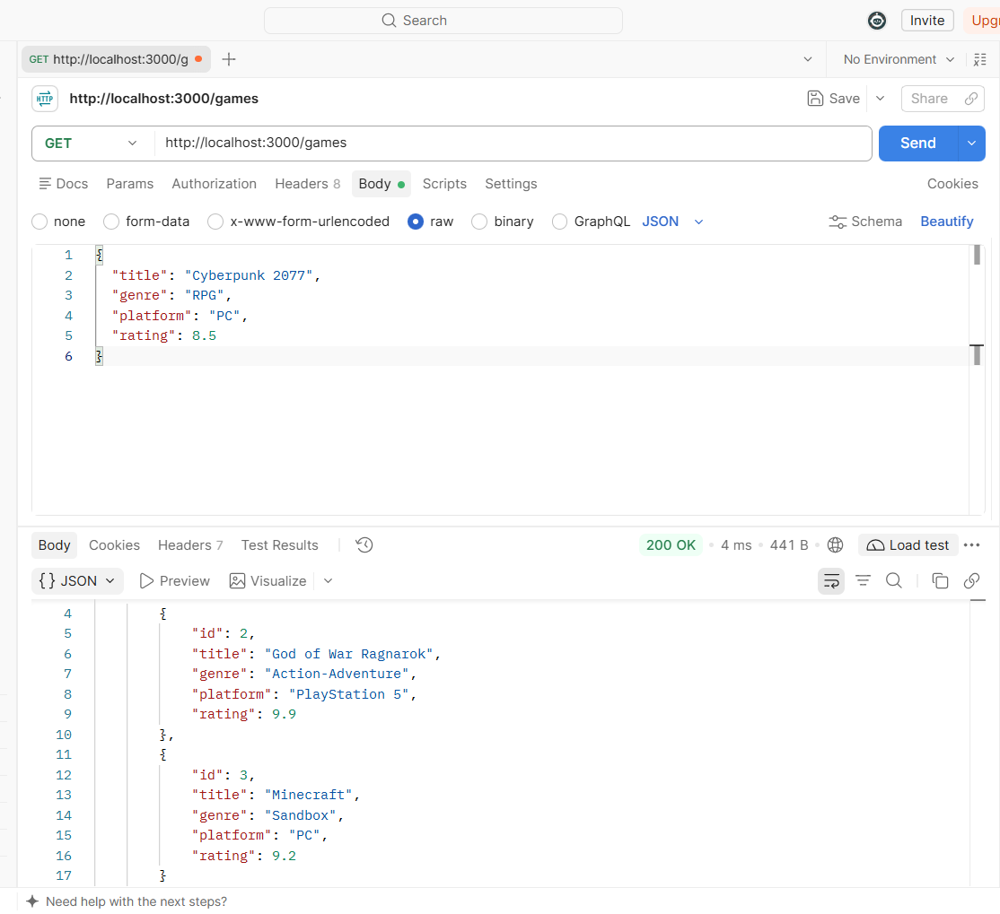
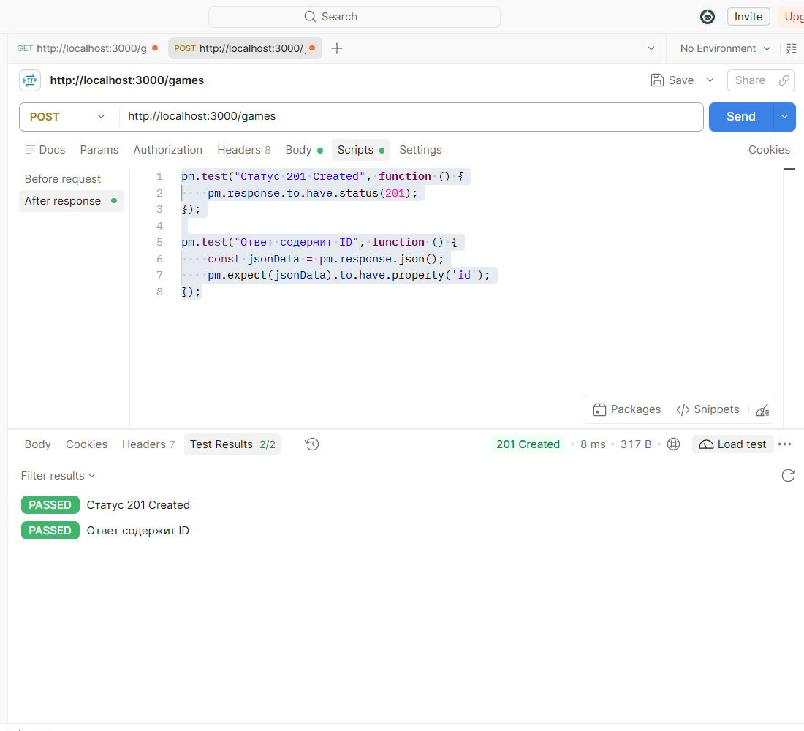
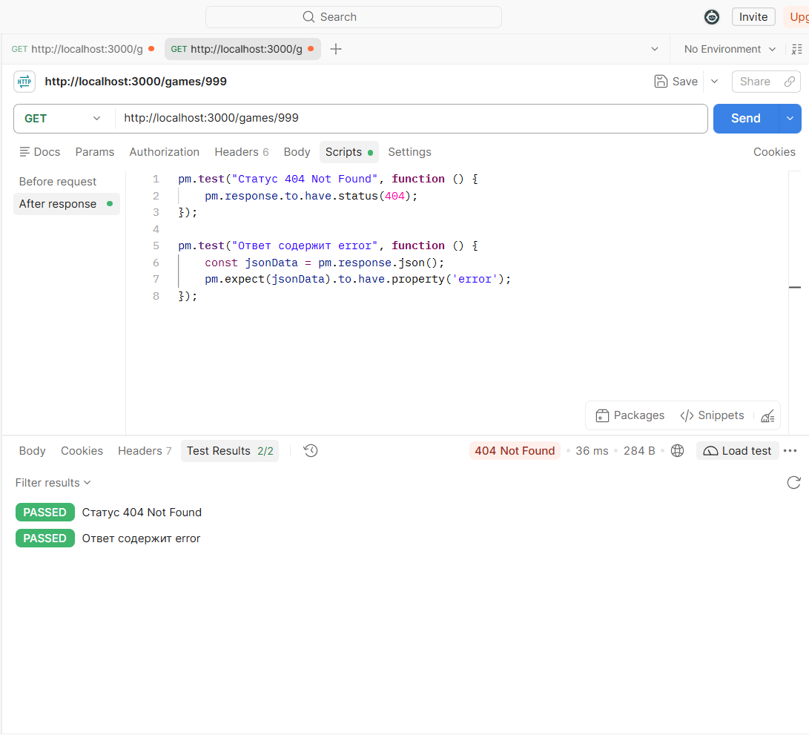
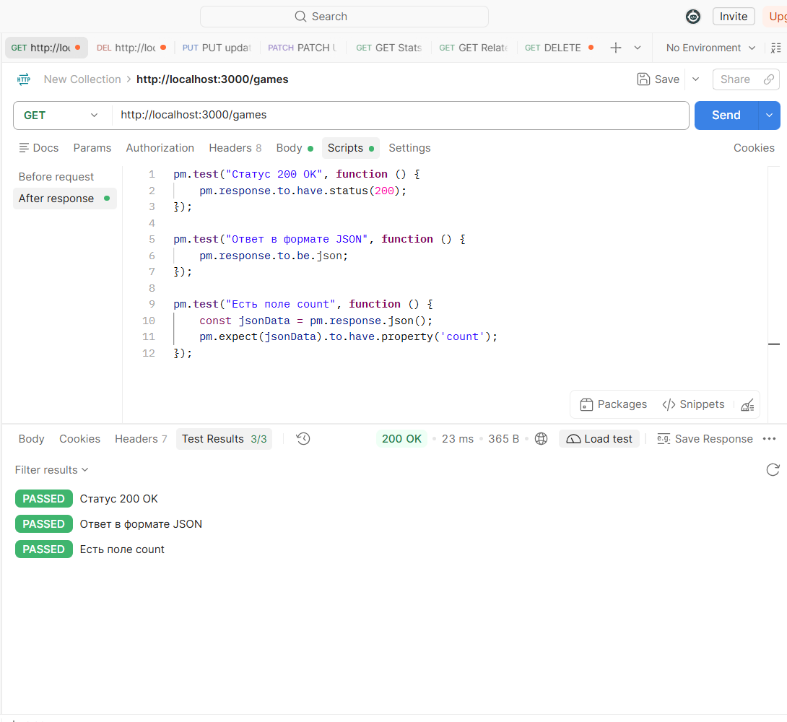
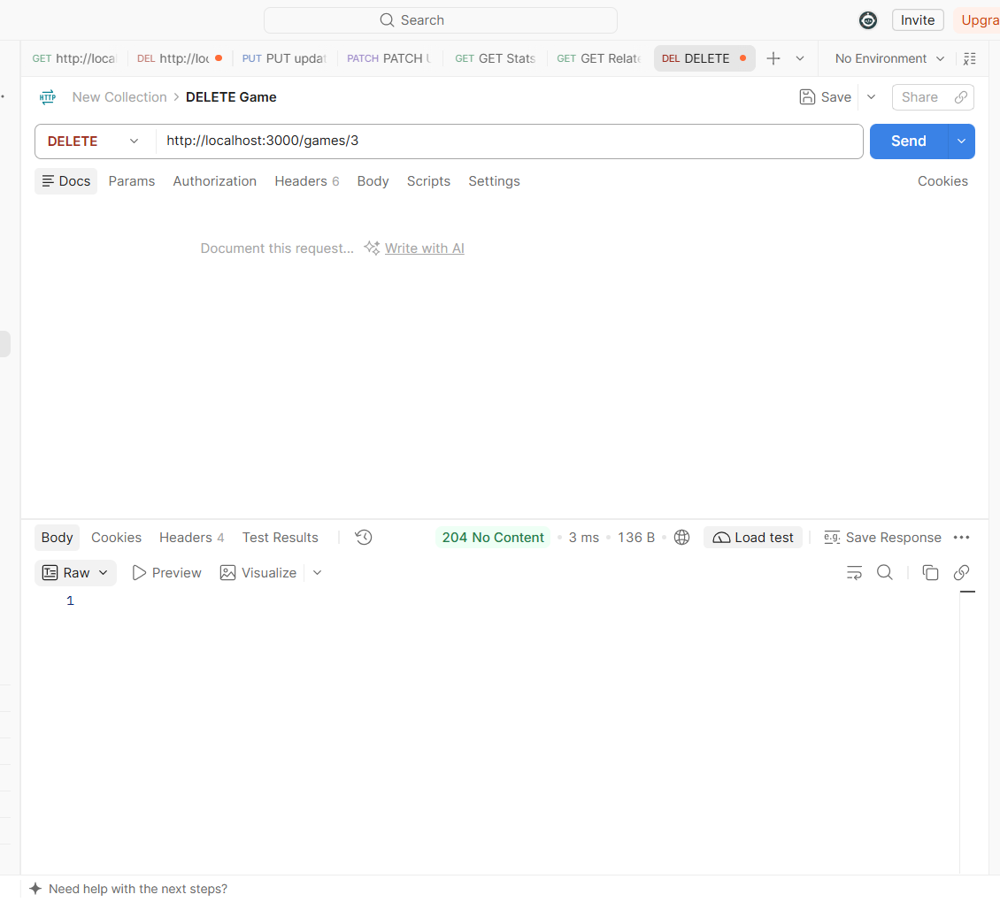
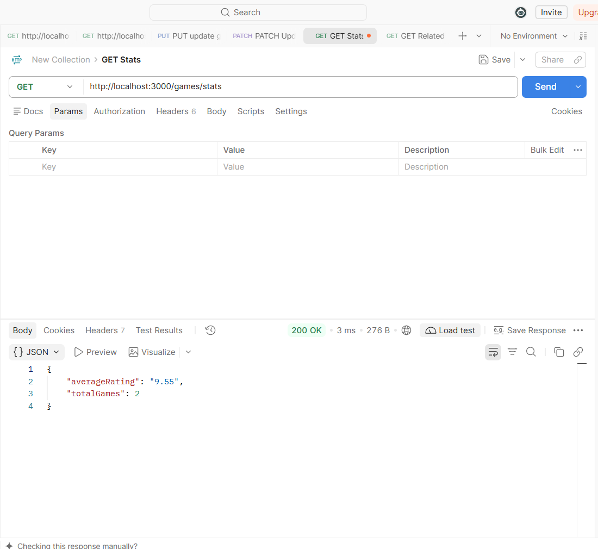
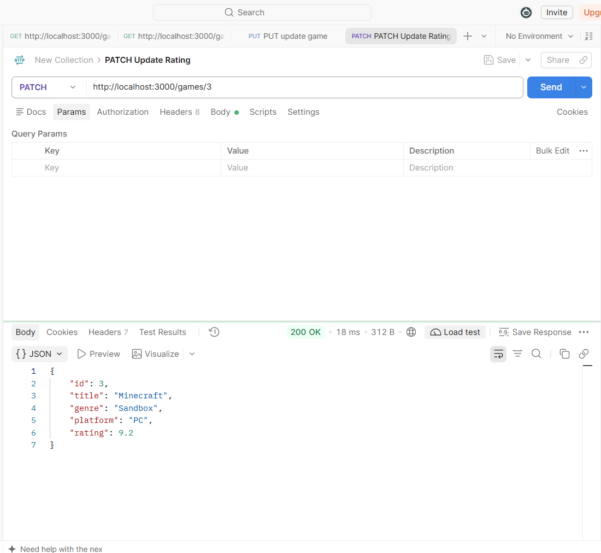

# Лабораторная работа №2: HTTP-методы и CRUD-операции

**Студент:** [Твоя Фамилия Имя Отчество]
**Группа:** [Твоя группа]
**Вариант:** 12 (Игры / games)
**Технология:** Node.js + Express + Postman

## Цель работы
Освоить обработку различных HTTP-методов (GET, POST, PUT, PATCH, DELETE) в Express. Научиться реализовывать CRUD-операции над коллекцией объектов, хранящейся в памяти сервера, а также возвращать корректные HTTP-коды ответов (200, 201, 204, 400, 404, 500).

## Теоретическое обоснование
CRUD — это акроним, обозначающий четыре базовые операции над данными: Create (создание, метод POST), Read (чтение, метод GET), Update (обновление, методы PUT/PATCH) и Delete (удаление, метод DELETE).

В данной работе данные хранятся в оперативной памяти (в виде массива JavaScript). Это удобно для тестирования, но данные сбрасываются при перезапуске сервера. Для тестирования API использовался инструмент Postman, позволяющий отправлять запросы с различными методами и телами (Body), а также писать автоматические тесты для проверки ответов сервера.

## Выполнение практического примера и индивидуального задания
В ходе работы был создан сервер на Express. Реализован продвинутый уровень (Вариант 12) для сущности "Игры". 
Добавлены дополнительные функции: частичное обновление (PATCH), массовое создание (POST /games/bulk), массовое удаление (DELETE /games), эндпоинт со статистикой (GET /games/stats), связанные элементы (GET /games/:id/related), логирование в файл `access.log` и глобальный обработчик ошибок 500.

### Код сервера (app.js)
```javascript
const express = require('express');
const fs = require('fs');
const app = express();
const port = 3000;

app.use(express.json());

app.use((req, res, next) => {
    const logEntry = `[${new Date().toISOString()}] ${req.method} ${req.url}\n`;
    console.log(logEntry.trim());
    fs.appendFile('access.log', logEntry, (err) => {
        if (err) console.error('Ошибка записи в файл:', err);
    });
    next();
});

let games = [
    { id: 1, title: 'The Witcher 3', genre: 'RPG', platform: 'PC', rating: 9.8 },
    { id: 2, title: 'God of War', genre: 'Action', platform: 'PlayStation', rating: 9.5 },
    { id: 3, title: 'Minecraft', genre: 'Sandbox', platform: 'PC', rating: 9.0 }
];
let nextId = 4;

app.get('/games', (req, res) => {
    res.json({ count: games.length, items: games });
});

app.get('/games/stats', (req, res) => {
    if (games.length === 0) return res.json({ averageRating: 0, total: 0 });
    const totalRating = games.reduce((sum, game) => sum + game.rating, 0);
    res.json({ 
        averageRating: (totalRating / games.length).toFixed(2),
        totalGames: games.length
    });
});

app.get('/games/:id', (req, res) => {
    const id = parseInt(req.params.id);
    const game = games.find(g => g.id === id);
    if (!game) return res.status(404).json({ error: 'Игра не найдена' });
    res.json(game);
});

app.get('/games/:id/related', (req, res) => {
    const id = parseInt(req.params.id);
    const game = games.find(g => g.id === id);
    if (!game) return res.status(404).json({ error: 'Игра не найдена' });
    
    const related = games.filter(g => g.platform === game.platform && g.id !== id);
    res.json({ platform: game.platform, relatedGames: related });
});

app.post('/games', (req, res) => {
    const { title, genre, platform, rating } = req.body;
    if (!title || !genre) return res.status(400).json({ error: 'Поля title и genre обязательны' });
    
    const newGame = { 
        id: nextId++, 
        title, 
        genre, 
        platform: platform || 'Unknown', 
        rating: rating || 0 
    };
    games.push(newGame);
    res.status(201).json(newGame);
});

app.post('/games/bulk', (req, res) => {
    const newGames = req.body;
    if (!Array.isArray(newGames)) return res.status(400).json({ error: 'Ожидается массив' });
    
    const created = newGames.map(g => {
        const newGame = { id: nextId++, ...g };
        games.push(newGame);
        return newGame;
    });
    res.status(201).json({ message: 'Игры добавлены', count: created.length, items: created });
});

app.put('/games/:id', (req, res) => {
    const id = parseInt(req.params.id);
    const index = games.findIndex(g => g.id === id);
    if (index === -1) return res.status(404).json({ error: 'Игра не найдена' });

    const { title, genre, platform, rating } = req.body;
    games[index] = { 
        id: id, 
        title: title || games[index].title, 
        genre: genre || games[index].genre,
        platform: platform || games[index].platform,
        rating: rating !== undefined ? rating : games[index].rating
    };
    res.json(games[index]);
});

app.patch('/games/:id', (req, res) => {
    const id = parseInt(req.params.id);
    const game = games.find(g => g.id === id);
    if (!game) return res.status(404).json({ error: 'Игра не найдена' });

    Object.assign(game, req.body);
    res.json(game);
});

app.delete('/games/:id', (req, res) => {
    const id = parseInt(req.params.id);
    const index = games.findIndex(g => g.id === id);
    if (index === -1) return res.status(404).json({ error: 'Игра не найдена' });

    games.splice(index, 1);
    res.status(204).send();
});

app.delete('/games', (req, res) => {
    games = [];
    nextId = 1;
    res.status(204).send();
});

app.use((req, res) => {
    res.status(404).json({ error: 'Маршрут не найден' });
});

app.use((err, req, res, next) => {
    console.error(err.stack);
    res.status(500).json({ error: 'Внутренняя ошибка сервера' });
});

app.listen(port, () => {
    console.log(`Сервер запущен на http://localhost:${port}`);
});
```
## Скриншоты работы в Postman
**1. Получение списка всех игр (GET /games)**


**2. Создание новой игры (POST /games)**


**3. Ошибка 404 (GET /games/999)**


**4. Автоматические тесты (Test Results)**


**5. Удаление игры (DELETE /games/3)**


**6. Статистика (GET /games/stats)**


**7. Частичное обновление (PATCH /games/3)**

---

## Ответы на контрольные вопросы (Продвинутый уровень)
Как реализовать частичное обновление (PATCH)?
В Express для этого используется метод app.patch(). В отличие от PUT, мы не перезаписываем объект целиком, а используем Object.assign(game, req.body), чтобы обновить только те поля, которые пришли в теле запроса.

Как реализовать массовое удаление элементов?
Можно использовать метод app.delete() на маршруте без параметра ID (например, /games). Внутри обработчика массив очищается (например, games = []), и возвращается статус 204.

Как реализовать глобальный обработчик ошибок?
В Express он добавляется в самом конце через app.use((err, req, res, next) => { ... }). Он перехватывает любые необработанные ошибки и возвращает статус 500.

Как логировать запросы в файл?
С помощью встроенного модуля fs. В middleware мы вызываем fs.appendFile('access.log', logEntry, ...), который дописывает строку с информацией о запросе в конец файла.

Что такое REST API?
Это архитектурный стиль для построения веб-сервисов. Он использует HTTP-методы для операций с ресурсами (URL), не хранит состояние между запросами (stateless) и обычно возвращает данные в формате JSON.

## Вывод
В ходе лабораторной работы я научился реализовывать полноценный CRUD API на Node.js/Express. Освоил работу с Postman: отправку запросов с разными методами, настройку Body в формате JSON, а также написание автоматических тестов для проверки статус-кодов и структуры ответа. Также были реализованы продвинутые функции: логирование в файл, обработка ошибок и статистика.

## Список использованных источников
Express документация — https://expressjs.com/

Postman Learning Center — https://learning.postman.com/

REST API Testing with Postman — https://www.postman.com/api-platform/api-testing/