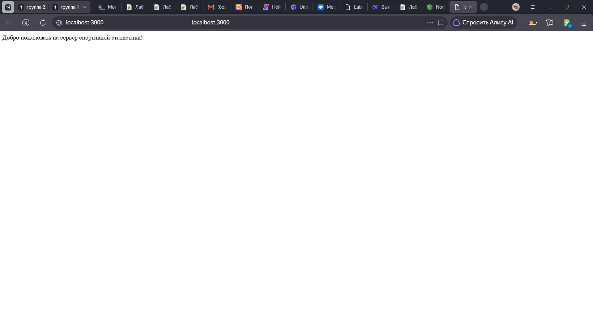
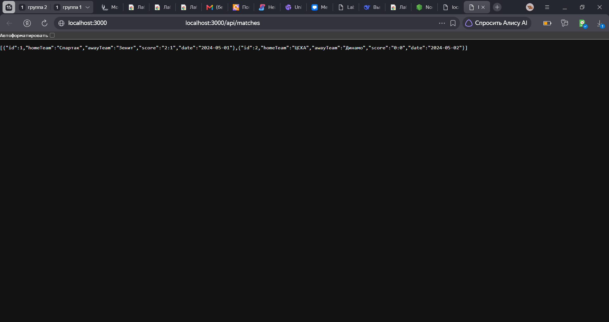
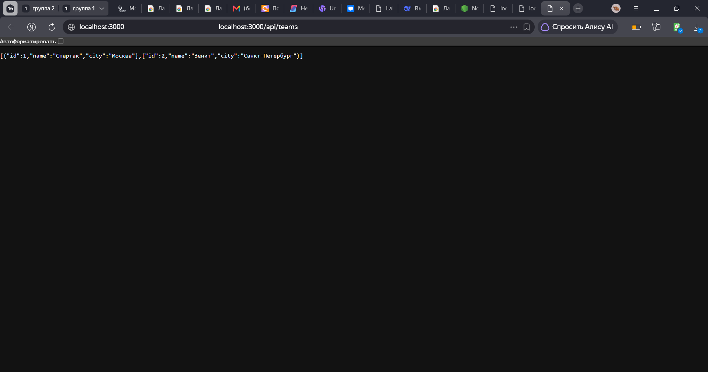
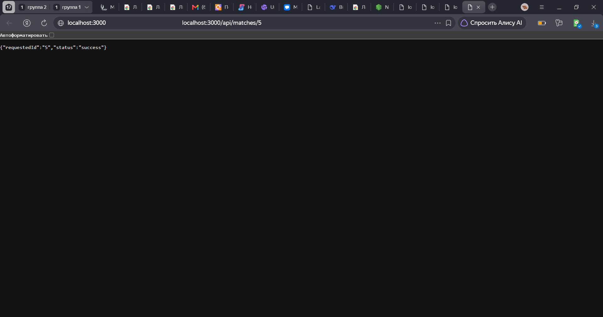
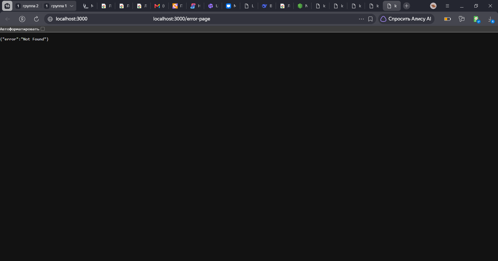
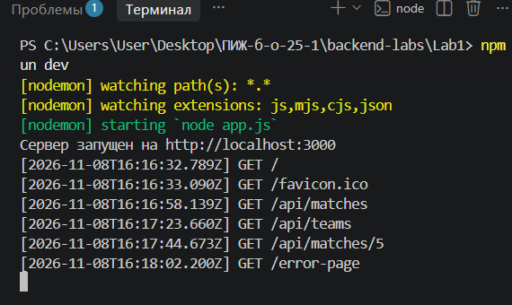

# Лабораторная работа №1: Настройка среды разработки и первый HTTP-сервер

**Студент:** Утов Алим Альбердович
**Группа:** ПИЖ-6-о-25-1
**Вариант:** 12 (Повышенный уровень)
**Технология:** Node.js + Express

## Цель работы
Освоить установку инструментов для бэкенд-разработки, создать и запустить минимальный веб-сервер, обрабатывающий GET-запросы, понять концепцию эндпоинтов, научиться настраивать автоматический перезапуск сервера.

## Теоретическое обоснование
В веб-разработке используется клиент-серверная архитектура. Клиент (например, браузер) отправляет HTTP-запрос на сервер, который обрабатывает его и возвращает HTTP-ответ. Взаимодействие происходит по протоколу HTTP. В данной работе используется метод GET, предназначенный исключительно для получения данных.

Для передачи данных между клиентом и сервером стандартом де-факто стал формат JSON (JavaScript Object Notation). Серверная часть работает на платформе Node.js с использованием фреймворка Express, который позволяет легко настраивать маршрутизацию (эндпоинты) и обрабатывать входящие запросы.

## Выполнение практического примера
В ходе работы был установлен Node.js и настроен проект. Для автоматического перезапуска сервера при изменении кода установлен пакет `nodemon`. Запуск сервера производится командой `npm run dev`.

## Выполнение индивидуального задания (Вариант 12)
Реализован продвинутый уровень. Сервер обрабатывает запросы к коллекциям `/api/matches` (Матчи) и `/api/teams` (Команды). Также реализован эндпоинт с параметром в пути `/api/matches/:id`, обработчик 404 ошибки и консольное логирование запросов.

### Код сервера (app.js)
```javascript
const express = require('express');
const app = express();
const port = 3000;

app.use((req, res, next) => {
    console.log(`[${new Date().toISOString()}] ${req.method} ${req.url}`);
    next();
});

app.get('/', (req, res) => {
    res.send('Добро пожаловать на сервер спортивной статистики!');
});

app.get('/api/matches', (req, res) => {
    res.json([
        { id: 1, homeTeam: 'Спартак', awayTeam: 'Зенит', score: '2:1', date: '2024-05-01' },
        { id: 2, homeTeam: 'ЦСКА', awayTeam: 'Динамо', score: '0:0', date: '2024-05-02' }
    ]);
});

app.get('/api/teams', (req, res) => {
    res.json([
        { id: 1, name: 'Спартак', city: 'Москва' },
        { id: 2, name: 'Зенит', city: 'Санкт-Петербург' }
    ]);
});

app.get('/api/matches/:id', (req, res) => {
    res.json({
        requestedId: req.params.id,
        status: 'success'
    });
});

app.use((req, res) => {
    res.status(404).json({ error: 'Not Found' });
});

app.listen(port, () => {
    console.log(`Сервер запущен на http://localhost:${port}`);
});
```
# Скриншоты работы
1. Текстовый эндпоинт (корень)


2. Сущность 1 (Матчи)


3. Сущность 2 (Команды)

4. Эндпоинт с параметром (ID)


5. Обработка ошибки 404


6. Консольное логирование запросов в терминале

--- 
## Ответы на контрольные вопросы:
Что такое клиент-серверная архитектура?
Это модель взаимодействия, где клиент (браузер, приложение) отправляет запросы, а сервер принимает их, обрабатывает и возвращает ответ.

Что такое эндпоинт (endpoint)?
Это конкретный адрес (URL) в сочетании с методом HTTP (например, GET /api/users), по которому клиент может обратиться к серверу для получения данных или выполнения действия.

Что такое JSON? Почему он популярен?
JSON — это текстовый формат обмена данными. Он популярен, потому что легко читается человеком, легко парсится программами и является стандартом для REST API.

Что такое автоматический перезапуск сервера и зачем он нужен?
Это функция (Hot Reload), которая перезапускает сервер при изменении файлов кода. Это нужно для того, чтобы разработчику не приходилось каждый раз вручную останавливать и запускать сервер, что экономит время.

Как получить параметр из URL-пути (например, ID) в вашем фреймворке?
В Express для этого используется специальный синтаксис в маршруте: app.get('/api/matches/:id'). Сам параметр извлекается из объекта req.params.id.

## Вывод
В ходе работы я освоил настройку среды для бэкенд-разработки, установил Node.js и Express. Я научился создавать HTTP-сервер, настраивать маршруты (эндпоинты), возвращать текстовые и JSON-ответы, а также обрабатывать параметры из URL. Кроме того, я настроил автоматический перезапуск сервера с помощью nodemon и реализовал консольное логирование. Трудностей не возникло, все команды и код работали корректно.

## Список использованных источников
Node.js официальная документация — https://nodejs.org/en/docs/

Express официальная документация — https://expressjs.com/

HTTP протокол (MDN) — https://developer.mozilla.org/ru/docs/Web/HTTP